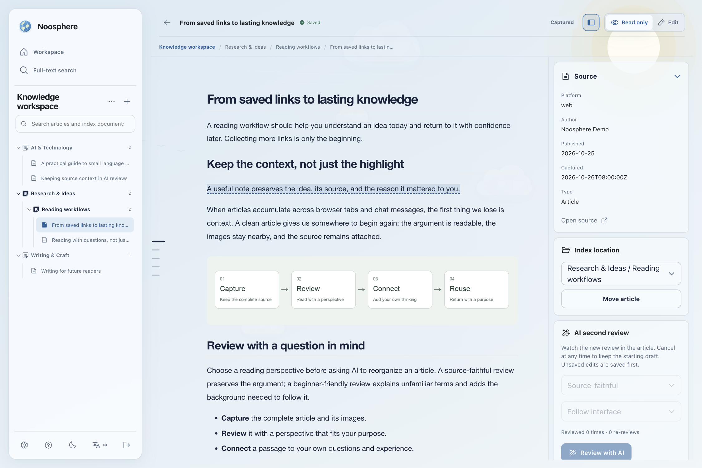
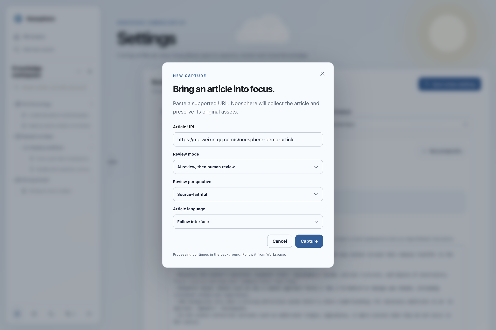
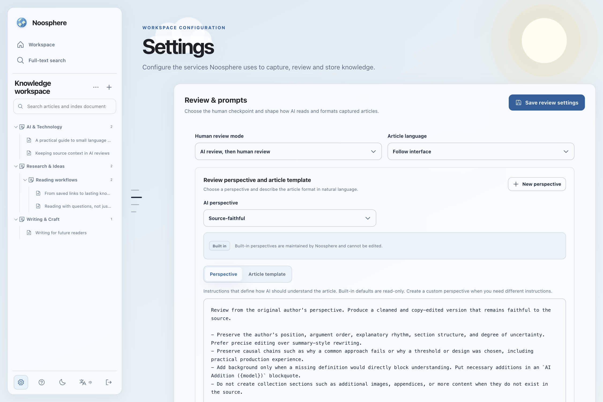
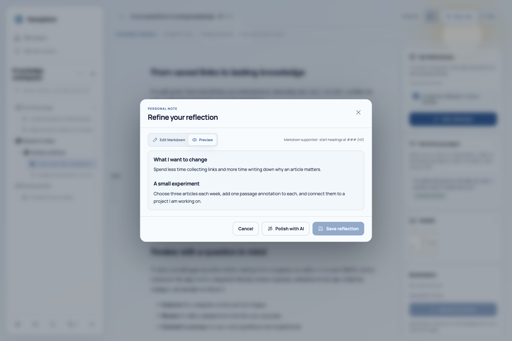
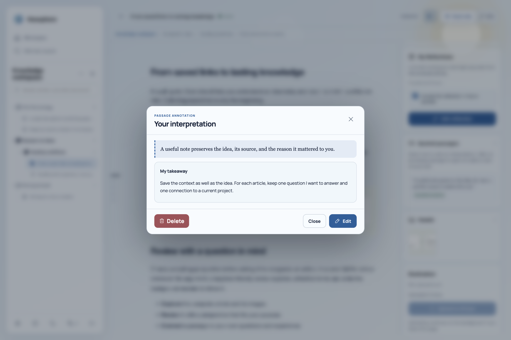

# Noosphere

[English](README.md) | [简体中文](docs/README.zh-CN.md)

Noosphere turns lengthy, noisy web articles into clean, structured reading material you can understand, organize, and keep.

Capture an article, review or translate it with AI, add your own thoughts, and archive it locally or send it to SiYuan. Use the web workspace for reading and editing, MCP for agent-driven workflows, or the CLI for scripts and automation. All three share the same articles and settings.



*Read with your Collections, article, and source details in one workspace. Screenshots use the English interface and sample content.*

## Features

### Capture articles, individually or in batches

Extract article text and download its images from supported platforms. Batch capture includes duplicate checks, saved progress, pause and cancel controls, and retries for failed items. Follow capture, review, and upload progress in the dashboard, with live article output and automatic task history. Re-reviews can also be cancelled.



*Choose how an article is reviewed and which language to read it in before capture.*

### Review and translate in your own style

Choose a built-in source-faithful or beginner-friendly perspective, or create your own. Describe the desired structure, language, and writing style in a natural-language article template. Noosphere reviews the full article, including long articles, rather than replacing it with a summary.

Original extractions stay intact, and source information is protected while you edit. Missing authors and publication dates can be supplemented when supported by evidence in the captured article. Configure your preferred AI providers and crawlers in Settings.



*Start with a built-in perspective, or create your own perspective and article template.*

### Coordinate text and images

Configure text and image review separately. AI analyzes what each image shows and how it supports the article, then keeps, repositions, or removes it to fit the reviewed text. Removed images remain recoverable. If image review is unavailable, downloaded images are preserved.

### Read, edit, and organize

Build Collections at any depth. Each Collection is a clickable index page with a title, introduction, and contents; articles can live at any level or remain unfiled. Create, rename, nest, and reorder Collections in the sidebar, with recovery for deleted Collections. Place articles manually or let AI classify them into existing Collections, and adjust their display order.

Read with an outline, or edit the article by moving paragraphs, quotes, lists, tables, and code blocks. Fold headings to manage longer sections, and use undo and redo while editing. Search reviewed article text with highlighted excerpts and jump between matches in the article.

### Add reflections and passage annotations

Keep personal reflections alongside an article and optionally ask AI to polish them. Review the preview before applying it, and choose whether to include your reflections when uploading that article.



*Write and preview your own reflections separately from the article.*

Select a passage to attach a Markdown interpretation. Annotated passages are underlined and open their notes when clicked; a side panel lets you navigate, edit, and delete annotations. Reflections and annotations stay separate from the article text and outside the search index. Passage annotations are excluded from uploads.



*Keep your interpretation attached to the passage that prompted it.*

### Archive and export

Keep reviewed articles and their assets locally, or upload them to SiYuan. Your original extraction, reviewed text, images, and personal notes remain available together for future reading and reuse.

## Supported Platforms

| Purpose | Platforms |
|---|---|
| Article capture | WeChat public account articles, Zhihu Zhuanlan, Xiaoheihe posts |
| Social post capture | X (Twitter), currently text-only |
| Note import | SiYuan |

## Get Started

### Web workspace

The Docker deployment includes the web workspace and MCP service.

```bash
git clone https://github.com/BorisZhangYYY/Noosphere.git
cd Noosphere
```

Before starting, set `NOOSPHERE_ACCESS_TOKEN` and `NOOSPHERE_DATABASE_PASSWORD` following the [credential setup instructions](docs/reliability-upgrade.md). Keep the existing database password when reusing a PostgreSQL data directory.

```bash
docker compose up -d --build
open http://localhost:8080/app/
```

See [Installation and deployment](docs/installation.md) for configuration and persistent storage.

### MCP

Start the Docker service above and connect your MCP client to `http://localhost:8080/sse`. See the [MCP reference](docs/mcp-reference.md) for available tools and usage.

You can also install the optional Codex/Claude-compatible Noosphere skill:

```bash
npx skills add https://github.com/BorisZhangYYY/Noosphere
```

### CLI

For local scripts and automation, clone the repository and install the CLI:

```bash
git clone https://github.com/BorisZhangYYY/Noosphere.git
cd Noosphere
python -m venv .venv
source .venv/bin/activate
pip install -e .
playwright install chromium
cp config.json.example config.json
nsphr --help
```

See the [CLI reference](docs/cli-reference.md) for commands and examples.

## License

Noosphere is available under the [MIT License](LICENSE).
